# Screenshots

A tour of the Platypus interface, captured with demonstration data. Images
use the light theme at 1280 pixels wide, with the test-mode banner hidden.
All addresses and values are examples.

## Overview

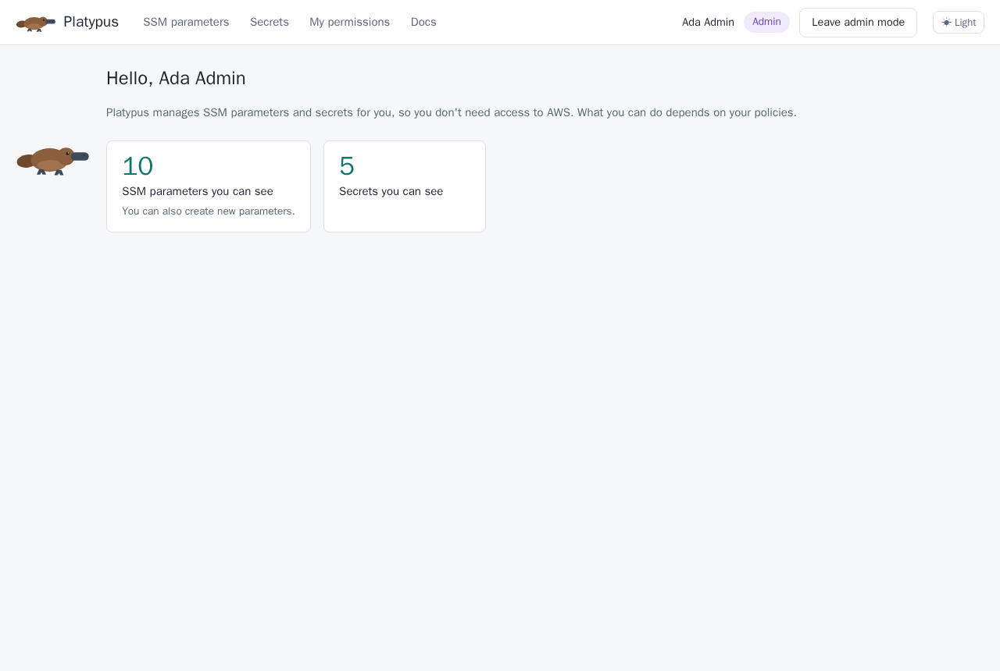

## SSM parameters

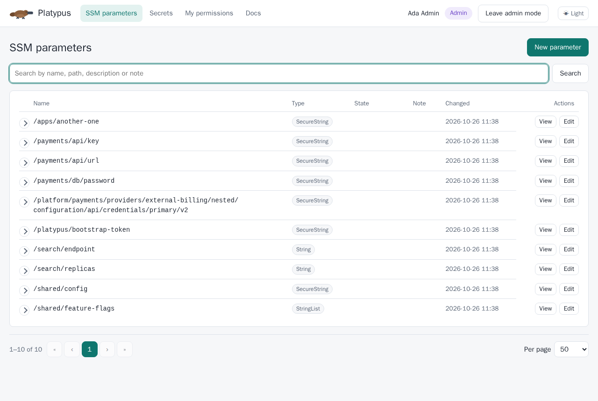

The list shows each parameter's name, type, state, note, and last change.
Expand a row to view its details.

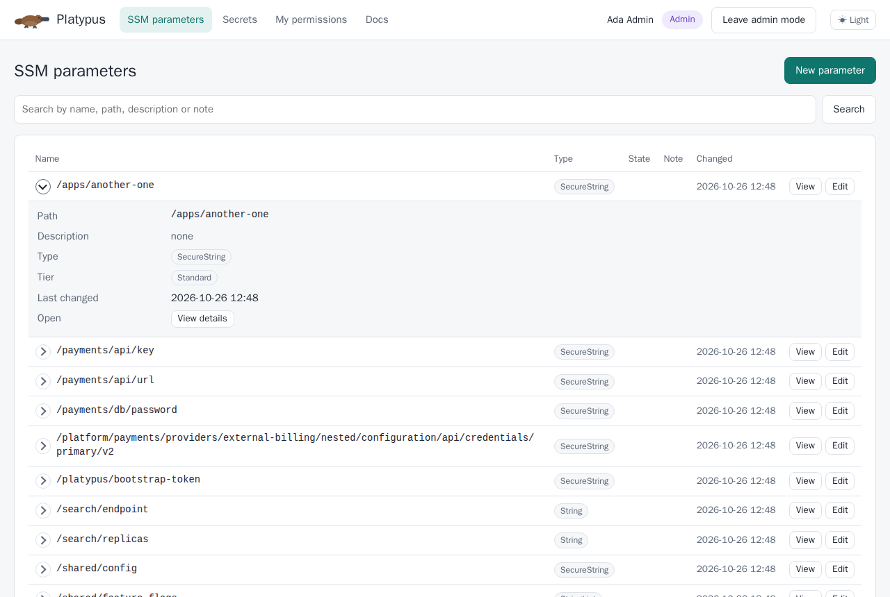

Expanded rows show the full path, description, type, tier, and note, with a
link to the parameter's page.

## Secrets

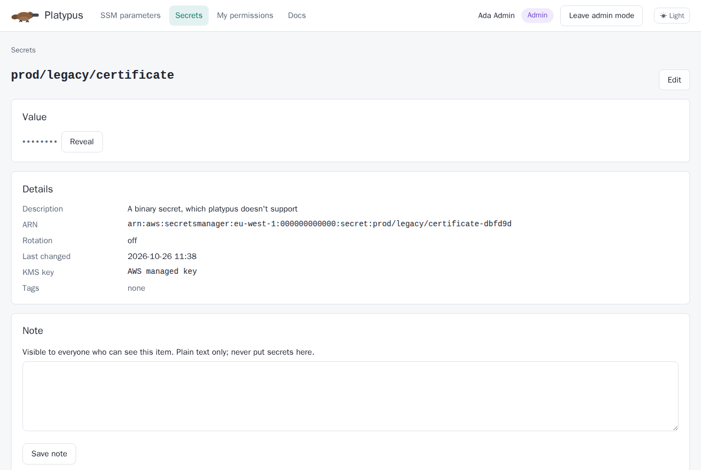

## Users

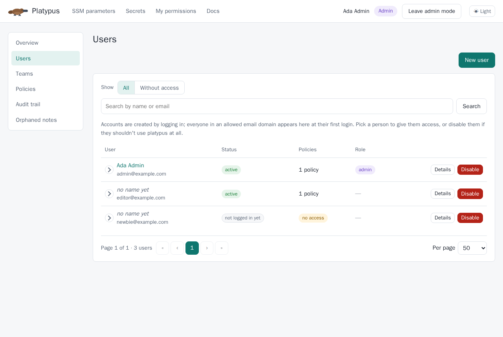

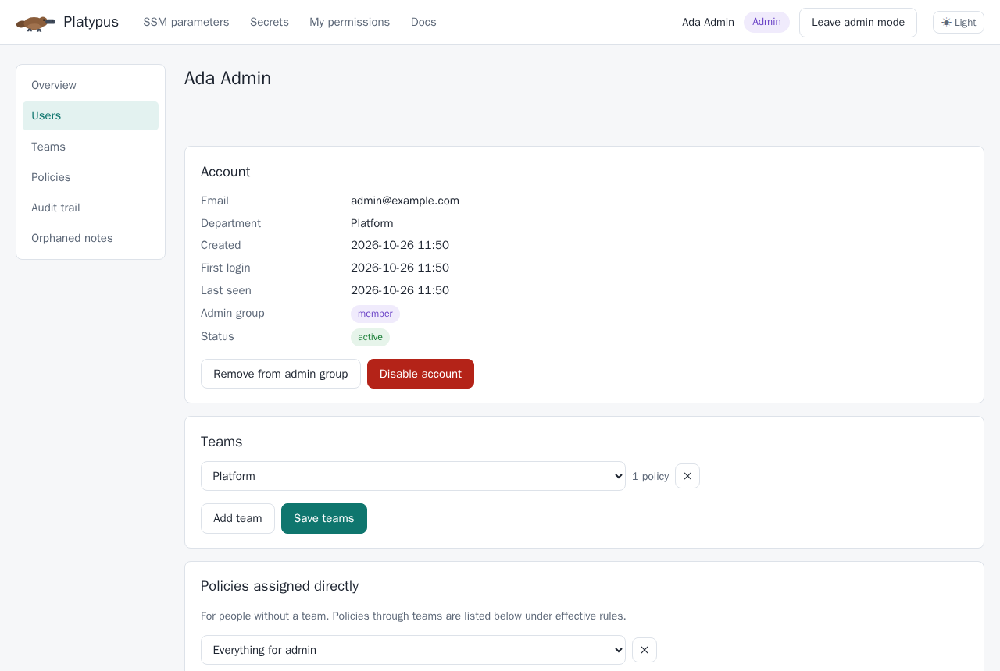

Manage team membership and directly assigned policies from the user's page.
"Add team" and "Add policy" offer entries that have not already been assigned.

## Teams

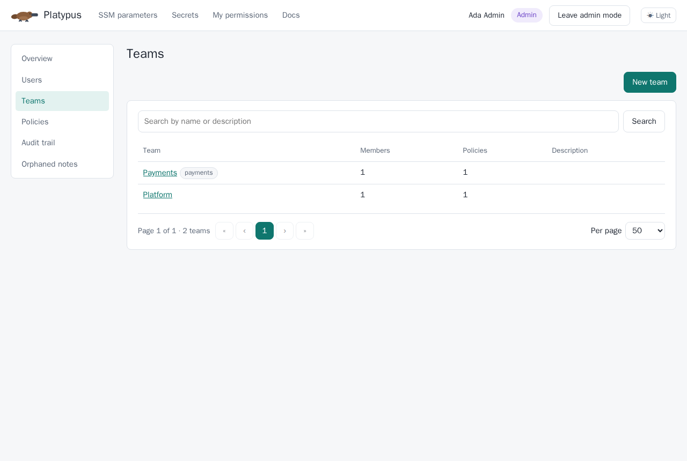

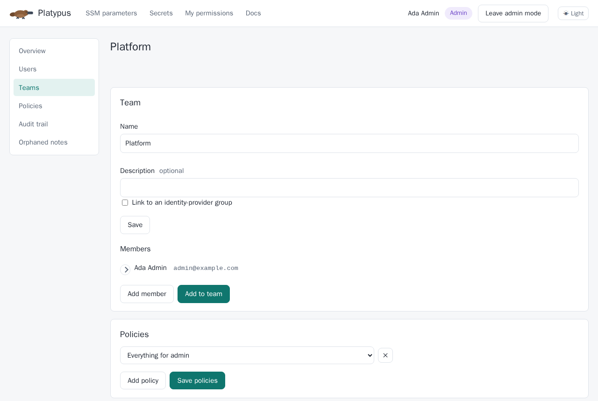

"Add member" lets you select an account that is not already on the team.
Team policies use the same assignment controls as the user page.

## Policies

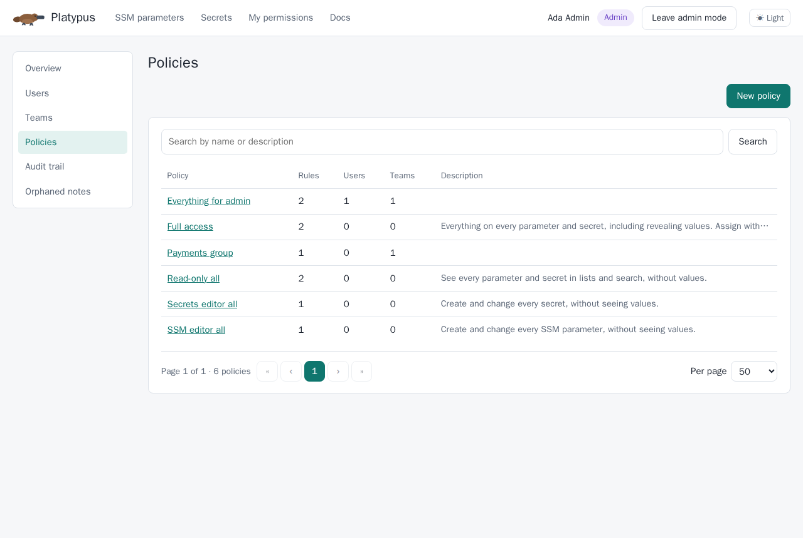

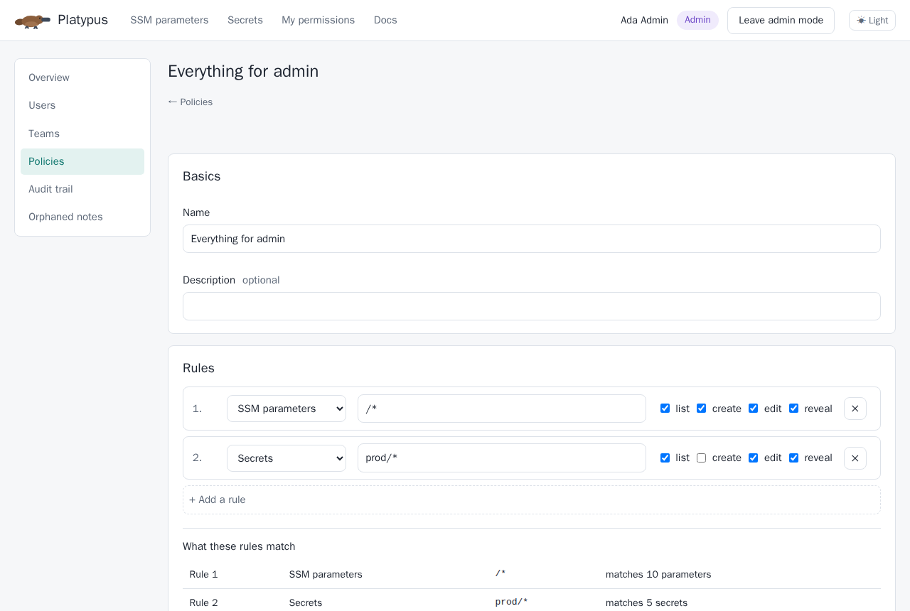

Preview which items each rule matches before saving a policy.

## Audit trail

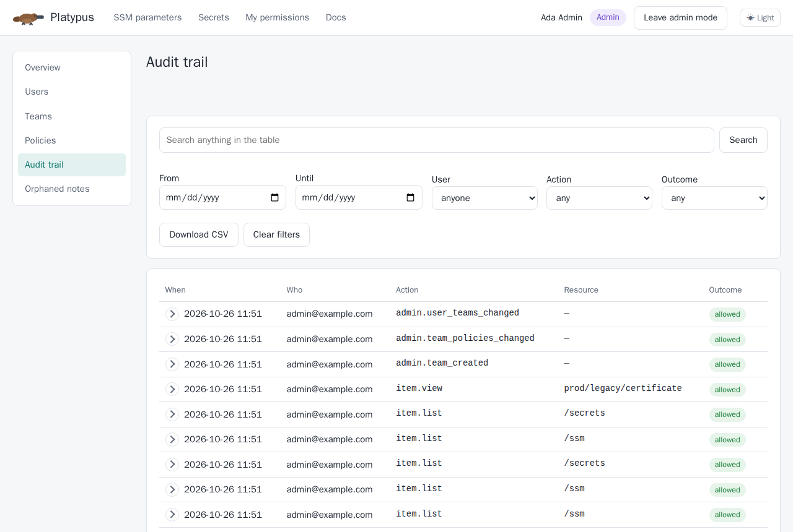

## Documentation

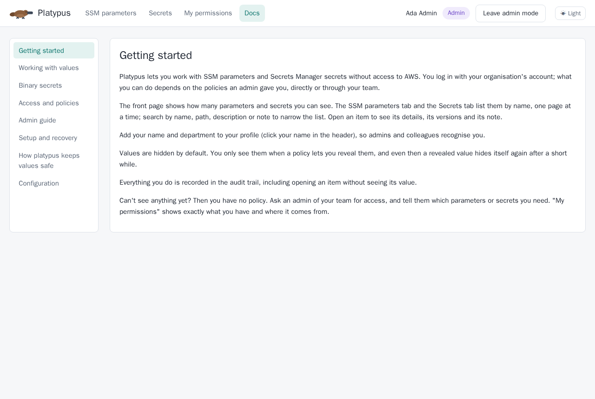

## Updating these images

Run the browser suite with screenshot capture enabled:

```sh
make screenshots
```

The command writes the images to `docs/images/`.
